# Marktvermessung EURUSD – Lauf `2026-11-03_vermessung-v1_proxy-ftmo`

> **⚠ PROXY-LAUF – NICHT EIGHTCAP.** Dieser Lauf nutzt eine öffentlich verfügbare MT5-Broker-Datenquelle, weil die Eightcap-Ticks in der Cloud-Umgebung nicht zugänglich sind. Alle Zahlen gelten für diese Quelle; Kommission/Swap von Eightcap sind **nicht** enthalten. Der Lauf ist mit Eightcap-Ticks 1:1 wiederholbar (siehe `CLAUDE.md`, Abschnitt Datenquellen).

- **Quelle:** FTMO-Server4 MT5, M1 aus Broker-Ticks (Mid), Proxy  
- **Datenart:** M1-Bars (Mid), Intrabar-Reihenfolge unbekannt  
- **Zeitraum (UTC):** 2025-01-01 22:05:00+00:00 – 2026-05-15 20:54:00+00:00 · 355 Handelstage · 506,630 M1-Bars · 506,630 Einstiegspunkte je Seite  
- **Konfiguration:** `EURUSD.toml` · X = [3, 5, 10, 20] Pips · Kappung 30 Tage

## Befunde (Kurzfassung)

| Messung | Bewertung für Nachkauf-System | Kernaussage |
|---|---|---|
| 1 Ausschlag vor X-Rücklauf | ⚪ NEUTRAL | MAE vor 10-Pip-Rücklauf: p50 7.1/6.9, p99 46/44, Max 124/98 Pips (Long/Short). Verhältnis p99 real/Zufallspfad = 0.94, p99.9 = 0.99; real/Theorie-RW p99 = 0.98. |
| 1b Gewinn +X ab Einstieg (ohne Nachkauf) | 🔴 SCHADET | Bis +10 Pips ab Einstieg: p99-MAE 408/482 Pips; 3.8 % / 4.2 % der Einstiege erreichen +10 nicht innerhalb von 30 Tagen (Long/Short). Ausschläge sind hier richtungs-/trendabhängig. |
| 2 Stunde/Session/Wochentag | ⚪ NEUTRAL | p99 (X=10) je Serverstunde schwankt um Faktor 1.52: schlechteste Stunden 21h (62), 23h (60), 13h (59); beste 2h (40), 16h (41), 11h (41). Sessions: höchstes p99 New York (55), niedrigstes Spät/Rollover (42). Wochentage: Fr am schlechtesten (63), Mi am besten (44). Stabilität (Spearman p99 erste vs. zweite Hälfte): Stunden 0.35, Sessions 0.45, Wochentage 0.60 – Stundenmuster wiederholt sich kaum (überwiegend von Einzelereignissen getrieben). |
| 3 Volatilitätsregime | ⚪ NEUTRAL | p99 (X=10) ex ante (ATR der Vortage): ruhigstes Quintil 46 → wildestes 46 Pips (Faktor 1.00); ex post (Tagesrange): Faktor 1.40. Vorab bekanntes Regime trennt die Ausschläge kaum; die Unterschiede zeigen sich erst ex post. |
| 4 Trend- vs. Rangetage | 🔴 SCHADET | Trendtage 19 %, Rangetage 28 %, Mischtage 53 % (355 Tage). Gegentrend-Einstiege an Trendtagen: p99 75 Pips vs. Rangetage 46 (Faktor 1.63). Früherkennung: beste AUC bis Serverstunde 10 = 0.59 (0,5 = Zufall), bis 14 = 0.55. |
| 5 Rückkehrneigung | 🟢 HILFT | VR(5/15/60) gesamt = 0.991/0.958/0.926; signifikant < 1 (Rückkehr) in 13, signifikant > 1 (Trend) in 2 von 18 Session×Horizont-Zellen; davon in beiden Halbjahren gleichgerichtet: 13 (<1) bzw. 1 (>1). Effektgröße klein: VR 0,93 auf 60 min heißt ~3,6 % weniger Schwankungsbreite (Std.) als ein Zufallspfad. AC1(1 min) gesamt = -0.0007. Halbwertszeit real vs. Zufallspfad: 60 min-Mittel 25 vs 27 min; 240 min-Mittel 97 vs 111 min. |
| 6 Extremphasen | ⚪ NEUTRAL | Längste Einbahnbewegung ohne 10-Pip-Rücklauf: 135 Pips (auf, Start Mon 23.03.2026 11:56 MEZ, 0.2 h). Längstes Bein real/Zufallspfad = 1.07; p99 der Beinlänge real 61 vs. 63 Pips. 5 der Top-20 enthalten einen Daten-/Ereignis-Slot. |
| 7 Kosten pro Zyklus | ⚪ NEUTRAL | Spread-Median typische Stunde 0.20 Pips (günstigste 1h 0.20, teuerste 0h 2.50). Nur Spread: Kosten > 20 % ab Ziel < 1.0 Pips, > 30 % ab < 0.7, > 50 % ab < 0.4 Pips. Kommission OFFEN (nicht aus Eightcap-Kontodaten belegt); bei 7 USD RT/Lot (= 0,70 Pips, nur Szenario) verschieben sich die Grenzen auf 4.5 / 3.0 / 1.8 Pips. |

Bewertungsregeln siehe Methodik (M-Regeln). „Zufallspfad“ = gleiche Daten, Minutenbewegungen innerhalb jedes Tages zufällig gemischt (gleiche Volatilität, keine Trend-/Rückkehrstruktur).

---
## Messung 1 – Ausschlagsverteilung (MAE vor X-Pip-Rücklauf)

**Def. A (Hauptmaß):** Einstieg zu jeder Minute; MAE = größter Gegenlauf, bevor der Kurs X Pips vom tiefsten (Long) bzw. höchsten (Short) Punkt zurückkommt. Werte in Pips.

|   X_pips | Seite   |      n |   p50 |   p90 |   p95 |   p99 |   p99.9 |   max |   zensiert_% |   Dauer_med_min |   Dauer_p99_min |   MAE=0_% |
|---------:|:--------|-------:|------:|------:|------:|------:|--------:|------:|-------------:|----------------:|----------------:|----------:|
|        3 | Long    | 506630 |   2.1 |   6.1 |   7.8 |  11.8 |    19.6 | 115.3 |        0.005 |               7 |              97 |       5.8 |
|        3 | Short   | 506630 |   2.1 |   6.1 |   7.8 |  11.7 |    17.8 |  95.4 |        0.012 |               7 |             106 |       5.8 |
|        5 | Long    | 506630 |   3.5 |  10.9 |  14   |  20.7 |    36.8 | 118.9 |        0.005 |              19 |             291 |       3.6 |
|        5 | Short   | 506630 |   3.5 |  10.9 |  14.1 |  21.6 |    33.7 |  95.4 |        0.029 |              19 |             257 |       3.6 |
|       10 | Long    | 506630 |   7.1 |  22.6 |  29   |  45.6 |    76.4 | 124.5 |        0.053 |              71 |            3065 |       1.8 |
|       10 | Short   | 506630 |   6.9 |  23.2 |  29.9 |  44.4 |    63.5 |  97.8 |        0.035 |              70 |            3035 |       1.9 |
|       20 | Long    | 506630 |  14.2 |  45.6 |  60.1 |  85.6 |   111.8 | 139.8 |        0.125 |             260 |            3584 |       0.9 |
|       20 | Short   | 506630 |  13.8 |  47.6 |  62.8 |  98   |   116.9 | 148   |        0.078 |             261 |            3833 |       0.9 |

**Zufallspfad-Benchmark (Shuffle):**

|   X_pips | Seite   |   p50 |   p90 |   p95 |   p99 |   p99.9 |   max |
|---------:|:--------|------:|------:|------:|------:|--------:|------:|
|        3 | Long    |   2.1 |   5.9 |   7.4 |  11.4 |   20    | 115.3 |
|        3 | Short   |   2.1 |   5.9 |   7.4 |  11.4 |   19.64 |  95.4 |
|        5 | Long    |   3.4 |  10.7 |  13.8 |  21.4 |   34.44 | 115.3 |
|        5 | Short   |   3.5 |  11   |  14.1 |  21.5 |   35    |  95.4 |
|       10 | Long    |   6.9 |  22.6 |  29.4 |  49.2 |   70    | 117.1 |
|       10 | Short   |   7.1 |  23.3 |  30.2 |  46.6 |   72.04 | 100.2 |
|       20 | Long    |  13.4 |  46.1 |  59.5 |  88.8 |  112.3  | 128.6 |
|       20 | Short   |  14.4 |  46.2 |  59.3 |  87.1 |  118.4  | 194.6 |

**Theorie Random Walk** (MAE ~ Exponential mit Mittel X, Perzentil p = −X·ln(1−p)):

|   X_pips |   p50 |   p90 |   p95 |   p99 |   p99.9 |
|---------:|------:|------:|------:|------:|--------:|
|        3 |  2.08 |  6.91 |  8.99 | 13.82 |   20.72 |
|        5 |  3.47 | 11.51 | 14.98 | 23.03 |   34.54 |
|       10 |  6.93 | 23.03 | 29.96 | 46.05 |   69.08 |
|       20 | 13.86 | 46.05 | 59.91 | 92.1  |  138.16 |

**Sensitivität Intrabar-Reihenfolge** (Erholung vor Gegenlauf im selben Bar, optimistisch):

|   X_pips | Seite   |   p50 |   p90 |   p95 |   p99 |   p99.9 |   max |
|---------:|:--------|------:|------:|------:|------:|--------:|------:|
|        3 | Long    |   2.1 |   7.3 |   9.5 |  14.8 |    25.4 | 118.9 |
|        3 | Short   |   2.1 |   7.4 |   9.6 |  15.2 |    25.6 |  97.9 |
|        5 | Long    |   3.5 |  11.6 |  15   |  23.1 |    43.5 | 118.9 |
|        5 | Short   |   3.5 |  11.7 |  15.4 |  24.6 |    36.9 |  98.4 |
|       10 | Long    |   7.1 |  23   |  29.7 |  47.6 |    78.3 | 124.5 |
|       10 | Short   |   6.9 |  23.7 |  30.6 |  45.8 |    65.7 | 134.3 |
|       20 | Long    |  14.2 |  46.1 |  60.7 |  86.8 |   112   | 150.2 |
|       20 | Short   |  13.8 |  48.7 |  64.6 | 100.8 |   119.2 | 148   |

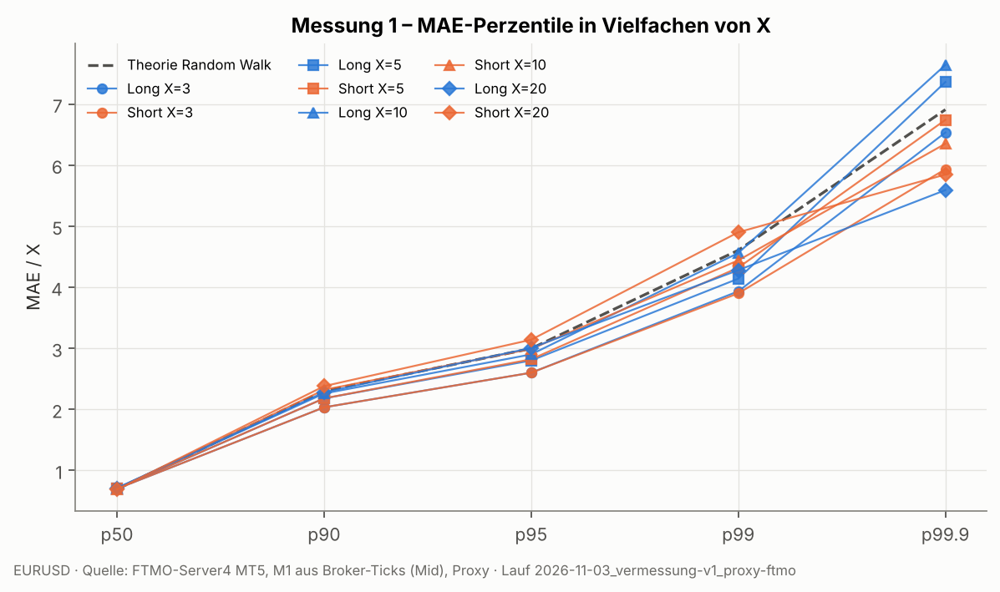

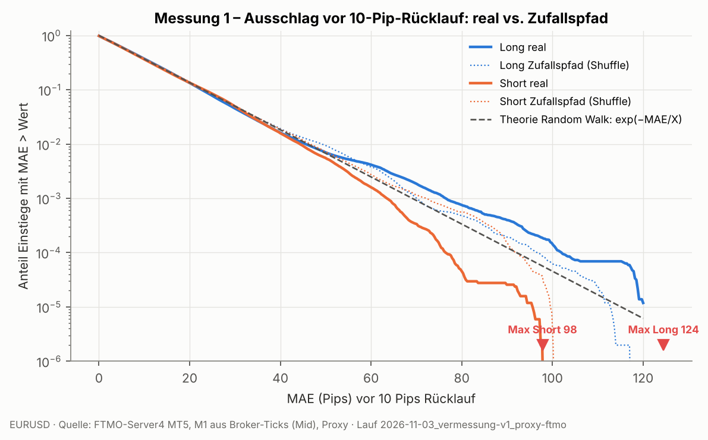

Weitere X: [X=3](../charts/2026-11-03_vermessung-v1_proxy-ftmo/01_mae_ccdf_X03.png), [X=5](../charts/2026-11-03_vermessung-v1_proxy-ftmo/01_mae_ccdf_X05.png), [X=10](../charts/2026-11-03_vermessung-v1_proxy-ftmo/01_mae_ccdf_X10.png), [X=20](../charts/2026-11-03_vermessung-v1_proxy-ftmo/01_mae_ccdf_X20.png)

**Def. B (Zusatz):** MAE, bis der Kurs **+X ab Einstieg** erreicht (eine Position, kein Nachkauf):

|   X_pips | Seite   |      n |   p50 |   p90 |   p95 |    p99 |   p99.9 |   max |   zensiert_% |   Dauer_med_min |   Dauer_p99_min |   MAE=0_% |
|---------:|:--------|-------:|------:|------:|------:|-------:|--------:|------:|-------------:|----------------:|----------------:|----------:|
|        3 | Long    | 506630 |   3   |  26.6 |  56.2 | 206.1  |  453    | 507.1 |        1.1   |              23 |         24214   |       5.8 |
|        3 | Short   | 506630 |   3   |  26.2 |  59.6 | 292    |  644.7  | 839.4 |        1.302 |              22 |         43201   |       5.8 |
|        5 | Long    | 506630 |   5   |  45.6 |  99.8 | 272.6  |  460.84 | 507.1 |        1.914 |              60 |         43201   |       3.6 |
|        5 | Short   | 506630 |   4.9 |  45.7 | 106.7 | 399.4  |  691    | 839.4 |        2.154 |              58 |         43201   |       3.6 |
|       10 | Long    | 506630 |  10.2 |  98.9 | 169.9 | 408.1  |  472.5  | 507.1 |        3.795 |             219 |         43201   |       1.8 |
|       10 | Short   | 506630 |   9.8 |  96.3 | 184.9 | 481.7  |  800.6  | 839.4 |        4.224 |             228 |         43751   |       1.9 |
|       20 | Long    | 506630 |  20.8 | 162.8 | 241.7 | 436.9  |  474    | 507.1 |        7.606 |             763 |         44657.7 |       0.9 |
|       20 | Short   | 506630 |  19.2 | 178.8 | 329.4 | 617.67 |  804.5  | 839.4 |        8.458 |             771 |         45256   |       0.9 |

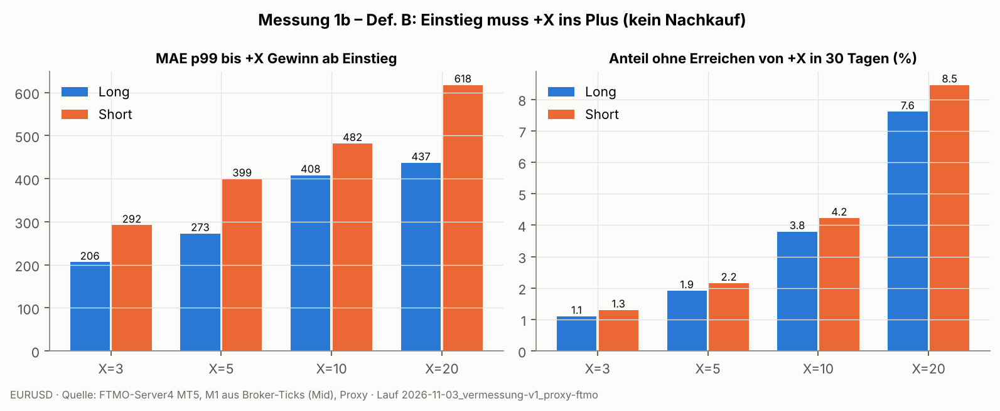

**Aussage:** ⚪ NEUTRAL – MAE vor 10-Pip-Rücklauf: p50 7.1/6.9, p99 46/44, Max 124/98 Pips (Long/Short). Verhältnis p99 real/Zufallspfad = 0.94, p99.9 = 0.99; real/Theorie-RW p99 = 0.98.

---
## Messung 2 – nach Stunde, Session, Wochentag

MAE vor 10-Pip-Rücklauf je Einstiegsstunde (Serverzeit; MEZ = Server − 1 h ganzjährig bei NY-Close-Server, außer in den DST-Lücken März/Okt–Nov):

|   hour_server |   max_Long |   max_Short |   p50_Long |   p50_Short |   p90_Long |   p90_Short |   p99_Long |   p99_Short |
|--------------:|-----------:|------------:|-----------:|------------:|-----------:|------------:|-----------:|------------:|
|             0 |       53.7 |        43.2 |        6.1 |         7.9 |      22.3  |       24.1  |      43    |       38.31 |
|             1 |       51.3 |        68   |        6.8 |         7.4 |      23.5  |       23.7  |      42    |       39.6  |
|             2 |       89.1 |        51.7 |        6.8 |         7.1 |      22.5  |       22.6  |      40.4  |       40.3  |
|             3 |       94.9 |        83.5 |        7.2 |         6.8 |      22.6  |       21    |      44.1  |       41.9  |
|             4 |       95.8 |        54   |        7.4 |         6.4 |      22.2  |       20.6  |      42.01 |       42    |
|             5 |       89.1 |        65.4 |        7.3 |         6.3 |      22.2  |       21.5  |      49.1  |       41.9  |
|             6 |       80.9 |        81.2 |        7.1 |         6.7 |      23.3  |       21.4  |      44.9  |       45.6  |
|             7 |       76.2 |        76   |        7   |         6.9 |      22.6  |       24.3  |      44.6  |       53.47 |
|             8 |       73.2 |        73.4 |        7   |         6.9 |      22.5  |       24.5  |      48.1  |       54.2  |
|             9 |       70.1 |        67.7 |        6.7 |         7   |      24.3  |       25.2  |      43.9  |       48.6  |
|            10 |       56   |        74.4 |        7   |         7   |      22.8  |       23.7  |      42    |       46.4  |
|            11 |       60.2 |        69.1 |        7.5 |         6.6 |      22.9  |       22.8  |      40.8  |       39.8  |
|            12 |       87.8 |        64.6 |        7.5 |         6.4 |      23.6  |       22.8  |      41.1  |       38.5  |
|            13 |       82.9 |        97.8 |        7.6 |         6.9 |      23.2  |       22.6  |      58.7  |       38.1  |
|            14 |       70.9 |        97.2 |        7.5 |         6.9 |      22.2  |       22    |      56.3  |       38.6  |
|            15 |       69.9 |        71.9 |        6.9 |         7.2 |      21.9  |       24.2  |      46.8  |       47.9  |
|            16 |      106.1 |        67.2 |        6.5 |         7.5 |      20.8  |       23.61 |      37.7  |       40.6  |
|            17 |      102.4 |        64.6 |        7   |         6.9 |      22.5  |       22.4  |      49.5  |       45    |
|            18 |       88.8 |        65.1 |        7.6 |         6.4 |      23.3  |       21    |      42.9  |       44.7  |
|            19 |       78.2 |        69   |        7.3 |         6.8 |      23.4  |       22.4  |      41.9  |       46.7  |
|            20 |       84.9 |        68.2 |        7.6 |         6.6 |      22.5  |       24.3  |      43.6  |       47    |
|            21 |       78.3 |        65.9 |        6.8 |         7   |      21.87 |       25.8  |      61.6  |       50.8  |
|            22 |       72.9 |        66.3 |        7.2 |         6.7 |      21.7  |       24.1  |      58.3  |       48.22 |
|            23 |      124.5 |        57.2 |        6.3 |         7.6 |      23.5  |       25.8  |      59.6  |       43.91 |

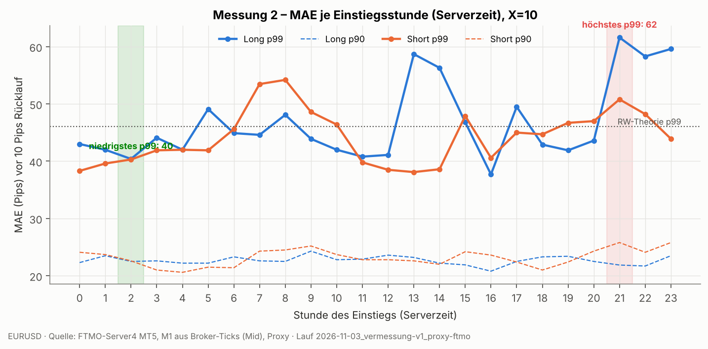

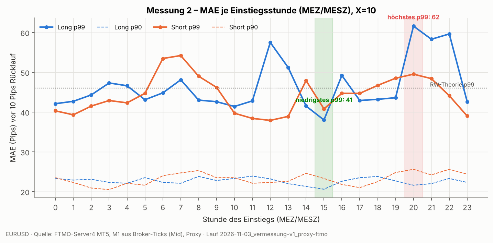

**Sessions:**

|   X_pips | Seite   | session            |      n |   p50 |   p90 |   p95 |   p99 |   p99.9 |   max |   zensiert_% |
|---------:|:--------|:-------------------|-------:|------:|------:|------:|------:|--------:|------:|-------------:|
|       10 | Long    | Asien              | 159240 |   7.1 |  22.7 |  29.3 | 44.76 |   82.28 |  95.8 |        0     |
|       10 | Long    | London             | 104396 |   7.4 |  23   |  28.6 | 44.2  |   72.36 |  87.8 |        0     |
|       10 | Long    | Überlappung LDN/NY |  87299 |   7   |  22   |  27.6 | 44.2  |   87.24 | 106.1 |        0     |
|       10 | Long    | New York           | 102842 |   7   |  22.6 |  29.5 | 54.9  |   76.1  | 124.5 |        0.261 |
|       10 | Long    | Spät/Rollover      |  52853 |   6.7 |  23   |  30.7 | 41.6  |   52.01 |  89.1 |        0     |
|       10 | Short   | Asien              | 159240 |   6.8 |  22.8 |  29.6 | 45.9  |   67.58 |  83.5 |        0     |
|       10 | Short   | London             | 104396 |   6.7 |  22.8 |  29.1 | 40.6  |   61.64 |  97.8 |        0     |
|       10 | Short   | Überlappung LDN/NY |  87299 |   7   |  22.9 |  29.5 | 44.2  |   62.57 |  71.9 |        0     |
|       10 | Short   | New York           | 102842 |   6.9 |  24.8 |  31.7 | 47.2  |   62.2  |  69   |        0.17  |
|       10 | Short   | Spät/Rollover      |  52853 |   7.4 |  23.4 |  28.7 | 39    |   50.11 |  68   |        0     |

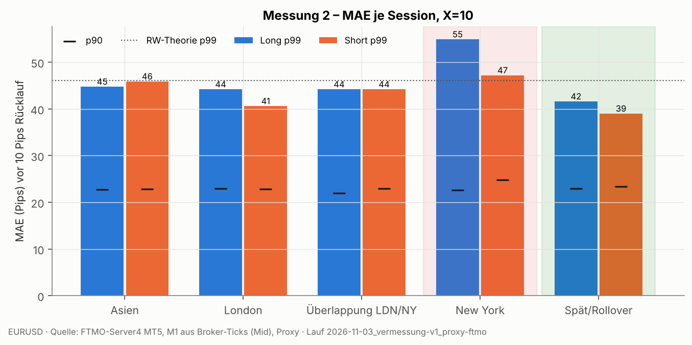

**Wochentage:**

|   X_pips | Seite   | weekday   |      n |   p50 |   p90 |   p95 |   p99 |   p99.9 |   max |   zensiert_% |
|---------:|:--------|:----------|-------:|------:|------:|------:|------:|--------:|------:|-------------:|
|       10 | Long    | Mo        | 101379 |   6.7 |  22.3 |  29   | 47.4  |   81.82 | 106.1 |        0     |
|       10 | Long    | Di        | 101290 |   7.1 |  22.5 |  28.4 | 41.1  |   54.17 |  64.8 |        0     |
|       10 | Long    | Mi        | 101348 |   6.9 |  22.8 |  29.1 | 44.2  |   66.57 |  87.8 |        0     |
|       10 | Long    | Do        |  99873 |   7.4 |  22.9 |  29.2 | 43.7  |   69.9  |  84.3 |        0     |
|       10 | Long    | Fr        | 102740 |   7.2 |  22.6 |  29.7 | 62.7  |   91.5  | 124.5 |        0.261 |
|       10 | Short   | Mo        | 101379 |   7.2 |  25   |  31   | 52.8  |   73.76 |  97.8 |        0     |
|       10 | Short   | Di        | 101290 |   6.9 |  23   |  29.9 | 44.4  |   62.27 |  76   |        0     |
|       10 | Short   | Mi        | 101348 |   7.1 |  22.2 |  29   | 38.8  |   53.4  |  65.1 |        0     |
|       10 | Short   | Do        |  99873 |   6.4 |  21.3 |  28.9 | 45.93 |   62.2  |  74.4 |        0     |
|       10 | Short   | Fr        | 102740 |   6.9 |  24.2 |  30.1 | 42.3  |   55.53 |  83.5 |        0.17  |

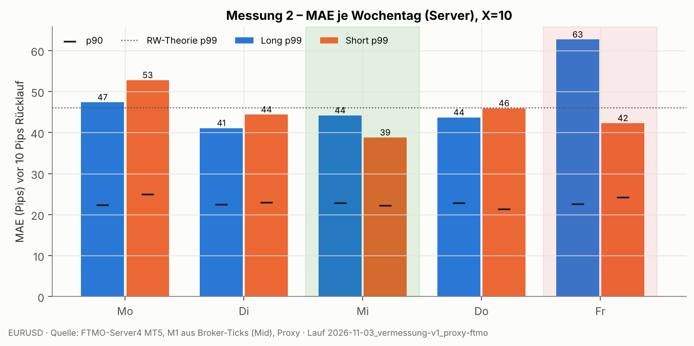

**Stabilität** (gleiche Rangfolge in erster und zweiter Hälfte des Zeitraums?):

| Gruppierung   |   X_pips | Seite   |   Perzentil |   Spearman_H1_H2 | Teilung_bei   |
|:--------------|---------:|:--------|------------:|-----------------:|:--------------|
| hour_server   |       10 | Long    |          90 |            -0.21 | 2025-09-08    |
| hour_server   |       10 | Short   |          90 |             0.05 | 2025-09-08    |
| hour_server   |       10 | Long    |          99 |             0.3  | 2025-09-08    |
| hour_server   |       10 | Short   |          99 |             0.4  | 2025-09-08    |
| session       |       10 | Long    |          90 |             0.5  | 2025-09-08    |
| session       |       10 | Short   |          90 |            -0.21 | 2025-09-08    |
| session       |       10 | Long    |          99 |             0.3  | 2025-09-08    |
| session       |       10 | Short   |          99 |             0.6  | 2025-09-08    |
| weekday       |       10 | Long    |          90 |            -0.67 | 2025-09-08    |
| weekday       |       10 | Short   |          90 |            -0.2  | 2025-09-08    |
| weekday       |       10 | Long    |          99 |             0.9  | 2025-09-08    |
| weekday       |       10 | Short   |          99 |             0.3  | 2025-09-08    |

Alle X und Gruppen: `../results/2026-11-03_vermessung-v1_proxy-ftmo/m2_*.csv`

**Aussage:** ⚪ NEUTRAL – p99 (X=10) je Serverstunde schwankt um Faktor 1.52: schlechteste Stunden 21h (62), 23h (60), 13h (59); beste 2h (40), 16h (41), 11h (41). Sessions: höchstes p99 New York (55), niedrigstes Spät/Rollover (42). Wochentage: Fr am schlechtesten (63), Mi am besten (44). Stabilität (Spearman p99 erste vs. zweite Hälfte): Stunden 0.35, Sessions 0.45, Wochentage 0.60 – Stundenmuster wiederholt sich kaum (überwiegend von Einzelereignissen getrieben).

---
## Messung 3 – Volatilitätsregime

Tagesrange (Serverstunde 0–24) und ATR14 = Mittel der 14 Vortages-Ranges (ohne Vorschau). Quintile über den Zeitraum.

| Regimeart               | Regime   |   X_pips | Seite   |   ATR14_median |      n |   p50 |   p90 |   p95 |   p99 |   p99.9 |   max |   zensiert_% |   p99_in_ATR |
|:------------------------|:---------|---------:|:--------|---------------:|-------:|------:|------:|------:|------:|--------:|------:|-------------:|-------------:|
| ex ante (ATR14 Vortage) | Q1 ruhig |       10 | Long    |           52.9 |  98258 |   7   |  22.4 |  28.3 | 46    |   72.6  |  80.3 |        0     |        0.87  |
| ex ante (ATR14 Vortage) | Q2       |       10 | Long    |           69.1 |  98324 |   7.5 |  23.3 |  29.2 | 40.6  |   53.34 |  71.3 |        0.273 |        0.588 |
| ex ante (ATR14 Vortage) | Q3       |       10 | Long    |           78.6 |  98549 |   7   |  22.1 |  29.2 | 60.3  |   97.25 | 124.5 |        0     |        0.767 |
| ex ante (ATR14 Vortage) | Q4       |       10 | Long    |           89.5 |  98584 |   7   |  22.6 |  28.2 | 45.9  |   76.44 |  87.8 |        0     |        0.513 |
| ex ante (ATR14 Vortage) | Q5 wild  |       10 | Long    |           98.1 |  98633 |   6.8 |  23.5 |  30.9 | 45.8  |   63.64 |  80.1 |        0     |        0.467 |
| ex ante (ATR14 Vortage) | Q1 ruhig |       10 | Short   |           52.9 |  98258 |   7   |  23.5 |  29.8 | 39.24 |   62.8  |  69.2 |        0     |        0.742 |
| ex ante (ATR14 Vortage) | Q2       |       10 | Short   |           69.1 |  98324 |   6.6 |  22.7 |  29.2 | 43.4  |   61.44 |  72.3 |        0.178 |        0.628 |
| ex ante (ATR14 Vortage) | Q3       |       10 | Short   |           78.6 |  98549 |   7   |  22.7 |  29.8 | 46.6  |   57.95 |  74.4 |        0     |        0.593 |
| ex ante (ATR14 Vortage) | Q4       |       10 | Short   |           89.5 |  98584 |   7   |  23.5 |  29.9 | 42.8  |   73    |  81.2 |        0     |        0.478 |
| ex ante (ATR14 Vortage) | Q5 wild  |       10 | Short   |           98.1 |  98633 |   7.1 |  24   |  31   | 45.8  |   59.4  |  97.8 |        0     |        0.467 |
| ex post (Tagesrange)    | Q1 ruhig |       10 | Long    |           61.5 | 101110 |   7.5 |  21.8 |  26   | 38    |   60.5  |  67.4 |        0     |        0.618 |
| ex post (Tagesrange)    | Q2       |       10 | Long    |           78.3 | 101300 |   7.4 |  23.4 |  29.5 | 44.1  |   73.37 |  84.9 |        0.265 |        0.563 |
| ex post (Tagesrange)    | Q3       |       10 | Long    |           78.7 | 101337 |   7   |  21.9 |  28   | 39.1  |   54.3  |  71.3 |        0     |        0.497 |
| ex post (Tagesrange)    | Q4       |       10 | Long    |           86.5 | 101455 |   6.9 |  22.6 |  30.7 | 55.4  |   74.75 | 124.5 |        0     |        0.64  |
| ex post (Tagesrange)    | Q5 wild  |       10 | Long    |           86.9 | 101428 |   6.5 |  23.9 |  31.8 | 53.3  |   93.7  | 106.1 |        0     |        0.613 |
| ex post (Tagesrange)    | Q1 ruhig |       10 | Short   |           61.5 | 101110 |   6.7 |  21   |  27.4 | 37    |   46.1  |  59.6 |        0     |        0.602 |
| ex post (Tagesrange)    | Q2       |       10 | Short   |           78.3 | 101300 |   6.5 |  21.7 |  28.1 | 40.1  |   59.07 |  69   |        0.173 |        0.512 |
| ex post (Tagesrange)    | Q3       |       10 | Short   |           78.7 | 101337 |   6.9 |  23.9 |  31.6 | 49    |   63.27 |  71.9 |        0     |        0.623 |
| ex post (Tagesrange)    | Q4       |       10 | Short   |           86.5 | 101455 |   6.9 |  23.1 |  30.5 | 44.5  |   56.65 |  62.5 |        0     |        0.514 |
| ex post (Tagesrange)    | Q5 wild  |       10 | Short   |           86.9 | 101428 |   7.6 |  25.5 |  32.5 | 51.6  |   73.8  |  97.8 |        0     |        0.594 |

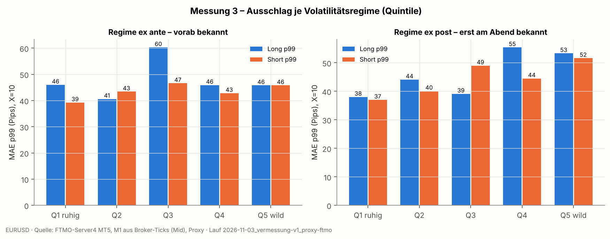

**Aussage:** ⚪ NEUTRAL – p99 (X=10) ex ante (ATR der Vortage): ruhigstes Quintil 46 → wildestes 46 Pips (Faktor 1.00); ex post (Tagesrange): Faktor 1.40. Vorab bekanntes Regime trennt die Ausschläge kaum; die Unterschiede zeigen sich erst ex post.

---
## Messung 4 – Trend- vs. Rangetage

Klassifikation je Servertag: **Trendtag** = |Close−Open|/Range ≥ 0,70 und Close im äußeren 15 %-Band in Bewegungsrichtung; **Rangetag** = |Close−Open|/Range ≤ 0,30; sonst **Mischtag**. Zusätzlich Effizienz = |Netto| / Summe |ΔM1| (in `m3_m4_tage.csv`).

| Tagtyp   |   Tage |
|:---------|-------:|
| Mischtag |    189 |
| Rangetag |    100 |
| Trendtag |     66 |

Effizienz-Ratio (Netto/Gesamtweg) Median: Trendtage 0.053, Rangetage 0.007, alle 0.027.

**MAE je Tagtyp** (Einstiege dieses Tages):

| Tagtyp               |   X_pips | Seite   |      n |   p50 |   p90 |   p95 |   p99 |   p99.9 |   max |   zensiert_% |
|:---------------------|---------:|:--------|-------:|------:|------:|------:|------:|--------:|------:|-------------:|
| Trendtag gegen Trend |       10 | Long    |  35690 |   9.6 |  28.6 |  35.5 | 75.21 |  100.03 | 106.1 |        0.751 |
| Trendtag mit Trend   |       10 | Long    |  58533 |   4.9 |  15.1 |  19.2 | 29.2  |   40.8  |  48.7 |        0     |
| Mischtag             |       10 | Long    | 269776 |   7.3 |  22.8 |  29.5 | 45.4  |   72.42 | 124.5 |        0     |
| Rangetag             |       10 | Long    | 142631 |   7.3 |  23.3 |  29.2 | 46    |   68.04 |  87.8 |        0     |
| Trendtag gegen Trend |       10 | Short   |  58533 |  10.1 |  30   |  35.6 | 53.07 |   74.9  |  81.2 |        0     |
| Trendtag mit Trend   |       10 | Short   |  35690 |   5   |  16   |  19.2 | 28.9  |   45.76 |  51.8 |        0.49  |
| Mischtag             |       10 | Short   | 269776 |   6.6 |  22.7 |  29.3 | 44.4  |   62.92 |  97.8 |        0     |
| Rangetag             |       10 | Short   | 142631 |   6.8 |  22.5 |  29.1 | 41.5  |   62.2  |  71.9 |        0     |

**Früherkennung** – Trennschärfe von Teiltagesmerkmalen (bis Serverstunde h) für „Trendtag“:

|   bis_Serverstunde |   p_body |   p_net_atr |   p_range_atr |
|-------------------:|---------:|------------:|--------------:|
|                  4 |    0.557 |       0.544 |         0.511 |
|                  8 |    0.54  |       0.531 |         0.501 |
|                 10 |    0.588 |       0.578 |         0.535 |
|                 12 |    0.591 |       0.578 |         0.521 |
|                 14 |    0.548 |       0.544 |         0.524 |
|                 16 |    0.658 |       0.617 |         0.523 |

|   bis_Serverstunde | Regel             |   Signal_Tage |   Trefferquote_% |   erfasste_Trendtage_% |   Richtung_richtig_% |   Basisrate_% |
|-------------------:|:------------------|--------------:|-----------------:|-----------------------:|---------------------:|--------------:|
|                  4 | |Netto| ≥ 0.3·ATR |            44 |             13.6 |                    9.4 |                100   |          18.6 |
|                  4 | |Netto| ≥ 0.5·ATR |            14 |             14.3 |                    3.1 |                100   |          18.6 |
|                  4 | |Netto| ≥ 0.7·ATR |             4 |             25   |                    1.6 |                100   |          18.6 |
|                  8 | |Netto| ≥ 0.3·ATR |            70 |             20   |                   21.9 |                 92.9 |          18.6 |
|                  8 | |Netto| ≥ 0.5·ATR |            22 |              9.1 |                    3.1 |                100   |          18.6 |
|                  8 | |Netto| ≥ 0.7·ATR |            10 |             10   |                    1.6 |                100   |          18.6 |
|                 10 | |Netto| ≥ 0.3·ATR |            87 |             25.3 |                   34.4 |                100   |          18.6 |
|                 10 | |Netto| ≥ 0.5·ATR |            31 |             16.1 |                    7.8 |                100   |          18.6 |
|                 10 | |Netto| ≥ 0.7·ATR |            13 |              7.7 |                    1.6 |                100   |          18.6 |
|                 12 | |Netto| ≥ 0.3·ATR |           117 |             22.2 |                   40.6 |                100   |          18.6 |
|                 12 | |Netto| ≥ 0.5·ATR |            55 |             27.3 |                   23.4 |                100   |          18.6 |
|                 12 | |Netto| ≥ 0.7·ATR |            25 |             24   |                    9.4 |                100   |          18.6 |
|                 14 | |Netto| ≥ 0.3·ATR |           137 |             23.4 |                   50   |                100   |          18.6 |
|                 14 | |Netto| ≥ 0.5·ATR |            64 |             26.6 |                   26.6 |                100   |          18.6 |
|                 14 | |Netto| ≥ 0.7·ATR |            33 |             30.3 |                   15.6 |                100   |          18.6 |
|                 16 | |Netto| ≥ 0.3·ATR |           171 |             24.6 |                   65.6 |                100   |          18.6 |
|                 16 | |Netto| ≥ 0.5·ATR |            94 |             26.6 |                   39.1 |                100   |          18.6 |
|                 16 | |Netto| ≥ 0.7·ATR |            53 |             28.3 |                   23.4 |                100   |          18.6 |

Hinweis: Die Tagesklasse nutzt den ganzen Tag (Rückschau). Die MAE-Werte je Tagtyp zeigen, wie teuer Trendtage sind, nicht, dass man sie vorab meiden kann – dafür zählt nur die Früherkennung.

Hinweis: Teiltag ist Teil des Tages – AUC enthält mechanische Überlappung; späte Stunden sind daher kaum noch „Früh“-Erkennung.

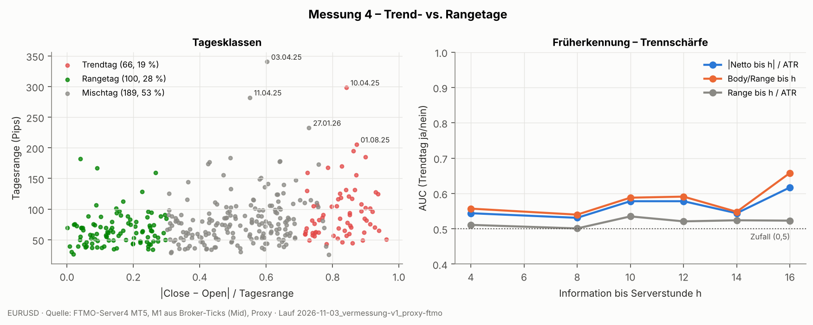

**Aussage:** 🔴 SCHADET – Trendtage 19 %, Rangetage 28 %, Mischtage 53 % (355 Tage). Gegentrend-Einstiege an Trendtagen: p99 75 Pips vs. Rangetage 46 (Faktor 1.63). Früherkennung: beste AUC bis Serverstunde 10 = 0.59 (0,5 = Zufall), bis 14 = 0.55.

---
## Messung 5 – Rückkehrneigung

Varianz-Ratio VR(q) = Var(q-min-Rendite)/(q·Var(1-min-Rendite)); < 1 = Rückkehrneigung, > 1 = Trendneigung. AC1 = Autokorrelation aufeinanderfolgender q-min-Renditen. 95 %-Band aus 30 Zufallspfaden.

| Session            |   Horizont_min |    VR |   VR_Null_2.5% |   VR_Null_97.5% |   VR_1.Hälfte |   VR_2.Hälfte |     AC1 |   AC1_Null_2.5% |   AC1_Null_97.5% |   n_AC |
|:-------------------|---------------:|------:|---------------:|----------------:|--------------:|--------------:|--------:|----------------:|-----------------:|-------:|
| Alle               |              1 | 1     |          1     |           1     |         1     |         1     | -0.0007 |         -0.0034 |           0.0043 | 511794 |
| Alle               |              5 | 0.991 |          0.994 |           1.012 |         0.999 |         0.974 | -0.019  |         -0.0082 |           0.009  | 101674 |
| Alle               |             15 | 0.958 |          0.984 |           1.02  |         0.973 |         0.928 | -0.0309 |         -0.011  |           0.0165 |  33296 |
| Alle               |             60 | 0.926 |          0.972 |           1.028 |         0.951 |         0.875 |  0.0045 |         -0.0358 |           0.0273 |   7736 |
| Asien              |              1 | 1     |          1     |           1     |         1     |         1     | -0.0041 |         -0.0055 |           0.0085 | 158945 |
| Asien              |              5 | 0.987 |          0.986 |           1.018 |         0.99  |         0.981 |  0.0023 |         -0.0138 |           0.0133 |  31505 |
| Asien              |             15 | 0.944 |          0.954 |           1.033 |         0.958 |         0.913 | -0.0161 |         -0.0172 |           0.0245 |   9910 |
| Asien              |             60 | 0.808 |          0.952 |           1.053 |         0.805 |         0.813 | -0.0409 |         -0.0522 |           0.0677 |   1945 |
| London             |              1 | 1     |          1     |           1     |         1     |         1     |  0.0032 |         -0.0064 |           0.0099 | 104045 |
| London             |              5 | 0.972 |          0.99  |           1.03  |         0.973 |         0.97  |  0.0021 |         -0.0204 |           0.0141 |  20525 |
| London             |             15 | 0.93  |          0.968 |           1.035 |         0.949 |         0.895 | -0.0333 |         -0.0355 |           0.0252 |   6250 |
| London             |             60 | 0.847 |          0.932 |           1.072 |         0.879 |         0.784 |  0.011  |         -0.1027 |           0.0863 |   1030 |
| Überlappung LDN/NY |              1 | 1     |          1     |           1     |         1     |         1     | -0.0069 |         -0.0073 |           0.0061 |  86945 |
| Überlappung LDN/NY |              5 | 0.979 |          0.988 |           1.018 |         0.989 |         0.957 | -0.0495 |         -0.0243 |           0.0175 |  17105 |
| Überlappung LDN/NY |             15 | 0.948 |          0.976 |           1.034 |         0.967 |         0.906 | -0.0414 |         -0.0332 |           0.0305 |   5110 |
| Überlappung LDN/NY |             60 | 0.888 |          0.905 |           1.06  |         0.912 |         0.834 |  0.0234 |         -0.0782 |           0.1124 |    745 |
| New York           |              1 | 1     |          1     |           1     |         1     |         1     |  0.0142 |         -0.0087 |           0.0057 | 104040 |
| New York           |              5 | 1.025 |          0.989 |           1.018 |         1.044 |         0.989 | -0.0061 |         -0.0153 |           0.0248 |  20524 |
| New York           |             15 | 0.968 |          0.97  |           1.049 |         0.966 |         0.974 | -0.0612 |         -0.0324 |           0.0279 |   6250 |
| New York           |             60 | 0.882 |          0.941 |           1.11  |         0.864 |         0.916 | -0.0234 |         -0.0817 |           0.0952 |   1030 |
| Spät/Rollover      |              1 | 1     |          1     |           1     |         1     |         1     | -0.0131 |         -0.0138 |           0.0107 |  56399 |
| Spät/Rollover      |              5 | 1.002 |          0.97  |           1.027 |         1.011 |         0.974 |  0.0075 |         -0.0232 |           0.0226 |  10595 |
| Spät/Rollover      |             15 | 1.024 |          0.943 |           1.064 |         1.034 |         0.987 |  0.0792 |         -0.038  |           0.0537 |   2936 |
| Spät/Rollover      |             60 | 1.364 |          0.87  |           1.154 |         1.339 |         1.354 |  0.17   |         -0.1737 |           0.1885 |    176 |

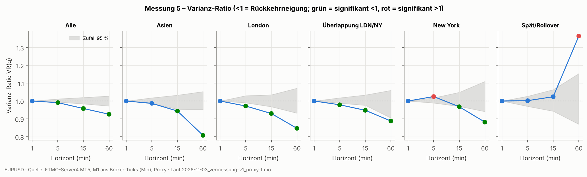

**Halbwertszeit** der Abweichung vom gleitenden Mittel (AR(1) auf 1-min-Basis), real vs. Zufallspfad (der gleitende Mittelwert erzeugt auch beim Zufallspfad eine scheinbare Rückkehr – nur die Differenz zählt):

|   Fenster_min | Reihe       | Session            |    beta |   Halbwertszeit_min |
|--------------:|:------------|:-------------------|--------:|--------------------:|
|            60 | real        | Alle               | 0.97228 |                24.7 |
|            60 | real        | Asien              | 0.97357 |                25.9 |
|            60 | real        | London             | 0.97253 |                24.9 |
|            60 | real        | Überlappung LDN/NY | 0.97113 |                23.7 |
|            60 | real        | New York           | 0.97122 |                23.7 |
|            60 | real        | Spät/Rollover      | 0.97715 |                30   |
|            60 | Zufallspfad | Alle               | 0.97466 |                27   |
|            60 | Zufallspfad | Asien              | 0.97417 |                26.5 |
|            60 | Zufallspfad | London             | 0.97521 |                27.6 |
|            60 | Zufallspfad | Überlappung LDN/NY | 0.97508 |                27.5 |
|            60 | Zufallspfad | New York           | 0.97458 |                26.9 |
|            60 | Zufallspfad | Spät/Rollover      | 0.97451 |                26.8 |
|           240 | real        | Alle               | 0.99286 |                96.7 |
|           240 | real        | Asien              | 0.99315 |               100.8 |
|           240 | real        | London             | 0.993   |                98.7 |
|           240 | real        | Überlappung LDN/NY | 0.99242 |                91.1 |
|           240 | real        | New York           | 0.99255 |                92.7 |
|           240 | real        | Spät/Rollover      | 0.99467 |               129.6 |
|           240 | Zufallspfad | Alle               | 0.99378 |               111.1 |
|           240 | Zufallspfad | Asien              | 0.99342 |               105   |
|           240 | Zufallspfad | London             | 0.99388 |               113   |
|           240 | Zufallspfad | Überlappung LDN/NY | 0.99412 |               117.5 |
|           240 | Zufallspfad | New York           | 0.99361 |               108.1 |
|           240 | Zufallspfad | Spät/Rollover      | 0.99428 |               120.9 |

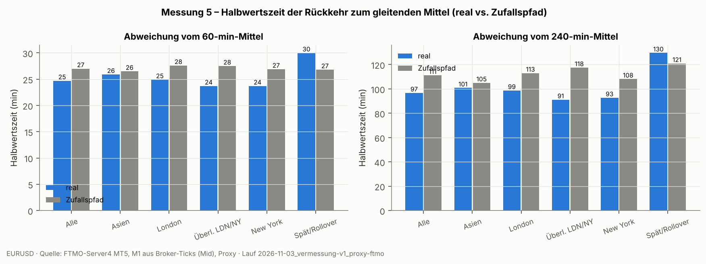

**Aussage:** 🟢 HILFT – VR(5/15/60) gesamt = 0.991/0.958/0.926; signifikant < 1 (Rückkehr) in 13, signifikant > 1 (Trend) in 2 von 18 Session×Horizont-Zellen; davon in beiden Halbjahren gleichgerichtet: 13 (<1) bzw. 1 (>1). Effektgröße klein: VR 0,93 auf 60 min heißt ~3,6 % weniger Schwankungsbreite (Std.) als ein Zufallspfad. AC1(1 min) gesamt = -0.0007. Halbwertszeit real vs. Zufallspfad: 60 min-Mittel 25 vs 27 min; 240 min-Mittel 97 vs 111 min.

---
## Messung 6 – Extremphasen

**Top 20 Einbahnbewegungen ohne 10-Pip-Rücklauf:**

|   # | Start_Server     | Start_MEZ            | Richtung   |   Länge_Pips |   Dauer_h |   Pips/h | Ereignis_im_Fenster                                             |
|----:|:-----------------|:---------------------|:-----------|-------------:|----------:|---------:|:----------------------------------------------------------------|
|   1 | 2026-03-23 13:56 | Mon 23.03.2026 11:56 | auf        |        134.8 |       0.2 |    735.3 |                                                                 |
|   2 | 2025-01-31 23:29 | Fri 31.01.2025 22:29 | ab         |        126   |      48.6 |      2.6 |                                                                 |
|   3 | 2025-08-01 15:26 | Fri 01.08.2025 14:26 | auf        |        123.6 |       0.1 |    824   | NFP (1. Fr 08:30 ET)                                            |
|   4 | 2025-04-09 20:21 | Wed 09.04.2025 19:21 | ab         |        117.6 |       0.1 |   1176   | US-Zollpause 90 Tage [Kandidat, unverifiziert]                  |
|   5 | 2025-04-11 03:25 | Fri 11.04.2025 02:25 | auf        |        116.1 |       0.1 |    774   |                                                                 |
|   6 | 2026-01-27 22:44 | Tue 27.01.2026 21:44 | auf        |        111.1 |       0.1 |   1333.2 |                                                                 |
|   7 | 2025-08-25 16:50 | Mon 25.08.2025 15:50 | ab         |        106.2 |       5.3 |     19.9 |                                                                 |
|   8 | 2025-07-16 17:59 | Wed 16.07.2025 16:59 | auf        |        104.7 |       0.3 |    314.1 |                                                                 |
|   9 | 2025-04-02 23:22 | Wed 02.04.2025 22:22 | ab         |        100.1 |       0.1 |    858   | US-Zollankündigung ('Liberation Day') [Kandidat, unverifiziert] |
|  10 | 2025-04-07 00:37 | Sun 06.04.2025 23:37 | auf        |         98.6 |       0.8 |    125.9 |                                                                 |
|  11 | 2026-03-13 04:12 | Fri 13.03.2026 02:12 | ab         |         96.9 |       7.2 |     13.5 |                                                                 |
|  12 | 2025-04-11 09:41 | Fri 11.04.2025 08:41 | auf        |         94.2 |       0.5 |    209.3 |                                                                 |
|  13 | 2025-04-03 13:08 | Thu 03.04.2025 12:08 | auf        |         90   |       0.1 |    900   |                                                                 |
|  14 | 2026-02-11 12:55 | Wed 11.02.2026 11:55 | ab         |         88.3 |       2.6 |     34   | US-Daten-Slot 08:30 ET                                          |
|  15 | 2025-06-20 20:19 | Fri 20.06.2025 19:19 | ab         |         85.5 |      51.8 |      1.7 |                                                                 |
|  16 | 2025-04-03 17:53 | Thu 03.04.2025 16:53 | ab         |         85   |       0.8 |    100   |                                                                 |
|  17 | 2025-01-21 02:10 | Tue 21.01.2025 01:10 | ab         |         82.6 |       0.8 |    103.3 |                                                                 |
|  18 | 2025-05-12 10:06 | Mon 12.05.2025 09:06 | ab         |         82.6 |       0.4 |    206.5 |                                                                 |
|  19 | 2025-06-02 06:38 | Mon 02.06.2025 05:38 | auf        |         82.4 |       4.2 |     19.5 |                                                                 |
|  20 | 2025-06-23 15:35 | Mon 23.06.2025 14:35 | auf        |         82   |       1.9 |     43.5 | US-Daten-Slot 08:30 ET                                          |

| stat   |   real |   zufallspfad |
|:-------|-------:|--------------:|
| n      | 9452   |        9493   |
| p50    |   17.2 |          17.4 |
| p90    |   33.8 |          34.5 |
| p99    |   61.2 |          63.4 |
| max    |  134.8 |         126.4 |

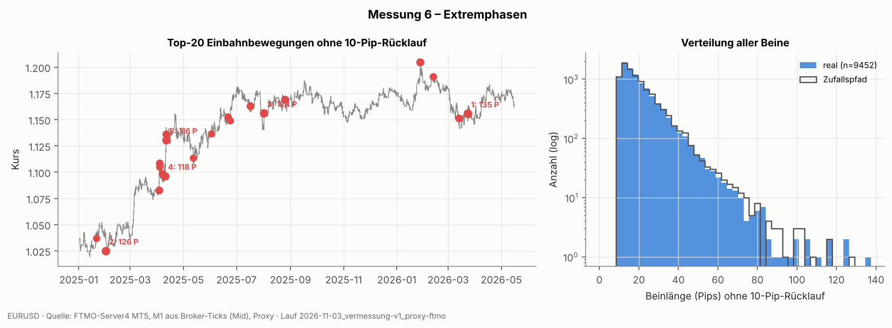

**Top 20 Einbahnbewegungen ohne 20-Pip-Rücklauf:**

|   # | Start_Server     | Start_MEZ            | Richtung   |   Länge_Pips |   Dauer_h |   Pips/h | Ereignis_im_Fenster    |
|----:|:-----------------|:---------------------|:-----------|-------------:|----------:|---------:|:-----------------------|
|   1 | 2025-04-11 02:44 | Fri 11.04.2025 01:44 | auf        |        158.3 |       0.8 |    190   |                        |
|   2 | 2025-01-31 23:07 | Fri 31.01.2025 22:07 | ab         |        151.6 |      49.9 |      3   |                        |
|   3 | 2025-08-01 15:26 | Fri 01.08.2025 14:26 | auf        |        136.4 |       0.2 |    682   | NFP (1. Fr 08:30 ET)   |
|   4 | 2026-03-23 13:56 | Mon 23.03.2026 11:56 | auf        |        134.8 |       0.2 |    735.3 |                        |
|   5 | 2025-07-16 17:39 | Wed 16.07.2025 16:39 | auf        |        134.1 |       0.7 |    201.1 |                        |
|   6 | 2026-01-19 11:25 | Mon 19.01.2026 10:25 | auf        |        132.6 |      27.1 |      4.9 | US-Daten-Slot 08:30 ET |
|   7 | 2026-04-13 02:24 | Mon 13.04.2026 01:24 | auf        |        132.6 |      31.7 |      4.2 | US-Daten-Slot 08:30 ET |
|   8 | 2025-04-04 08:27 | Fri 04.04.2025 07:27 | ab         |        132.2 |       2.6 |     50.8 |                        |
|   9 | 2025-03-04 17:20 | Tue 04.03.2025 16:20 | auf        |        127.3 |       5.1 |     25   |                        |
|  10 | 2025-07-28 03:16 | Mon 28.07.2025 02:16 | ab         |        126.9 |      11.3 |     11.2 |                        |
|  11 | 2026-03-03 03:25 | Tue 03.03.2026 02:25 | ab         |        125   |       9.9 |     12.6 |                        |
|  12 | 2026-01-27 19:29 | Tue 27.01.2026 18:29 | auf        |        124.3 |       3.3 |     37.3 |                        |
|  13 | 2025-04-03 12:27 | Thu 03.04.2025 11:27 | auf        |        124.1 |       0.8 |    158.4 |                        |
|  14 | 2025-01-20 01:24 | Mon 20.01.2025 00:24 | auf        |        123   |      14.2 |      8.7 | US-Daten-Slot 08:30 ET |
|  15 | 2026-02-06 17:33 | Fri 06.02.2026 16:33 | auf        |        121.4 |      71.5 |      1.7 | US-Daten-Slot 08:30 ET |
|  16 | 2025-04-15 19:43 | Tue 15.04.2025 18:43 | auf        |        121.2 |      13.3 |      9.1 |                        |
|  17 | 2025-07-28 17:46 | Mon 28.07.2025 16:46 | ab         |        120.6 |      16.4 |      7.3 |                        |
|  18 | 2025-03-05 05:00 | Wed 05.03.2025 04:00 | auf        |        120   |       6.5 |     18.3 |                        |
|  19 | 2026-04-17 16:12 | Fri 17.04.2026 15:12 | ab         |        119.9 |      57.3 |      2.1 |                        |
|  20 | 2025-04-22 20:57 | Tue 22.04.2025 19:57 | ab         |        119.9 |       4.2 |     28.8 |                        |

| stat   |   real |   zufallspfad |
|:-------|-------:|--------------:|
| n      | 2475   |        2510   |
| p50    |   34.5 |          34.2 |
| p90    |   67.2 |          69.1 |
| p99    |  116.2 |         118.8 |
| max    |  158.3 |         194.7 |

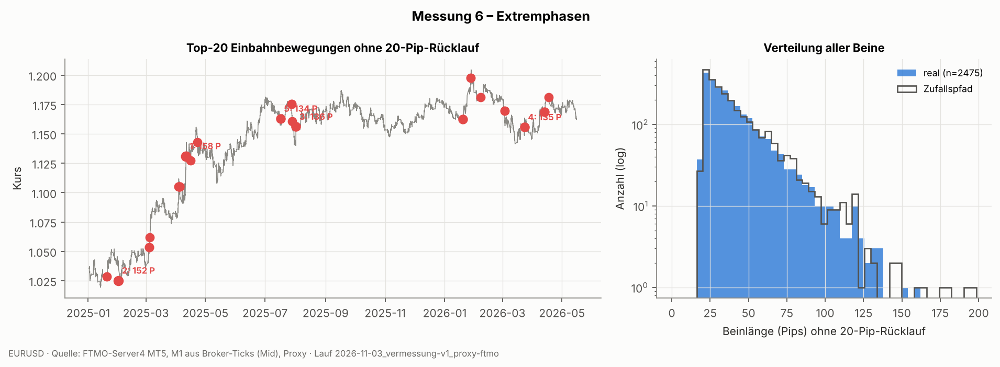

„Ereignis_im_Fenster“: regelbasierte Slots (US-Daten 08:30 ET, NFP = 1. Freitag) und ggf. ein mitgegebener Kalender. Ein Slot im Fenster ist ein **Hinweis, kein Beleg** für den Auslöser.

**Aussage:** ⚪ NEUTRAL – Längste Einbahnbewegung ohne 10-Pip-Rücklauf: 135 Pips (auf, Start Mon 23.03.2026 11:56 MEZ, 0.2 h). Längstes Bein real/Zufallspfad = 1.07; p99 der Beinlänge real 61 vs. 63 Pips. 5 der Top-20 enthalten einen Daten-/Ereignis-Slot.

---
## Messung 7 – Kosten pro Zyklus

Hinweis Auflösung: Bar-Spreads sind ganze Points (1 Point = 0,1 Pip); Median-Werte springen daher in 0,1-Pip-Stufen – der Mittelwert ist feiner. Tickdaten liefern exakte Spreads.

Spread je Serverstunde (Pips). Kosten pro Zyklus = 1 × Spread (Kauf zu Ask, Verkauf zu Bid) + Kommission (Round-Turn). Slippage nicht enthalten.

|   hour_server | MEZ_Stunde(n)   |   Spread_Median |   Spread_Mittel |   Spread_p90 |   Spread_p99 |   Spread_max |   n_Bars |
|--------------:|:----------------|----------------:|----------------:|-------------:|-------------:|-------------:|---------:|
|             0 | 22/23           |             2.5 |           3.128 |          4.8 |        8.9   |         12.1 |     2126 |
|             1 | 0/23            |             0.2 |           0.204 |          0.3 |        0.3   |          4.9 |     2130 |
|             2 | 0/1             |             0.2 |           0.135 |          0.2 |        0.3   |          6.2 |     2130 |
|             3 | 1/2             |             0.2 |           0.13  |          0.2 |        0.3   |          0.4 |     2130 |
|             4 | 2/3             |             0.2 |           0.128 |          0.2 |        0.3   |          0.4 |     2130 |
|             5 | 3/4             |             0.2 |           0.128 |          0.2 |        0.3   |          0.4 |     2130 |
|             6 | 4/5             |             0.2 |           0.128 |          0.2 |        0.3   |          0.3 |     2130 |
|             7 | 5/6             |             0.2 |           0.128 |          0.2 |        0.3   |          0.4 |     2130 |
|             8 | 6/7             |             0.2 |           0.129 |          0.2 |        0.3   |          0.4 |     2130 |
|             9 | 7/8             |             0.2 |           0.123 |          0.2 |        0.3   |          0.4 |     2130 |
|            10 | 8/9             |             0.2 |           0.123 |          0.2 |        0.3   |          0.4 |     2130 |
|            11 | 9/10            |             0.2 |           0.122 |          0.2 |        0.3   |          0.4 |     2130 |
|            12 | 10/11           |             0.2 |           0.121 |          0.2 |        0.2   |          0.3 |     2130 |
|            13 | 11/12           |             0.2 |           0.121 |          0.2 |        0.2   |          0.3 |     2130 |
|            14 | 12/13           |             0.2 |           0.122 |          0.2 |        0.2   |          0.4 |     2130 |
|            15 | 13/14           |             0.2 |           0.124 |          0.2 |        0.3   |          0.5 |     2130 |
|            16 | 14/15           |             0.2 |           0.122 |          0.2 |        0.2   |          0.5 |     2130 |
|            17 | 15/16           |             0.2 |           0.122 |          0.2 |        0.271 |          0.4 |     2130 |
|            18 | 16/17           |             0.2 |           0.122 |          0.2 |        0.2   |          0.3 |     2130 |
|            19 | 17/18           |             0.2 |           0.132 |          0.3 |        0.3   |          0.4 |     2130 |
|            20 | 18/19           |             0.2 |           0.131 |          0.2 |        0.3   |          0.6 |     2130 |
|            21 | 19/20           |             0.2 |           0.131 |          0.2 |        0.3   |          0.5 |     2130 |
|            22 | 20/21           |             0.2 |           0.132 |          0.2 |        0.3   |          3.1 |     2130 |
|            23 | 21/22           |             0.3 |           0.411 |          0.8 |        2.7   |          6.6 |     2129 |

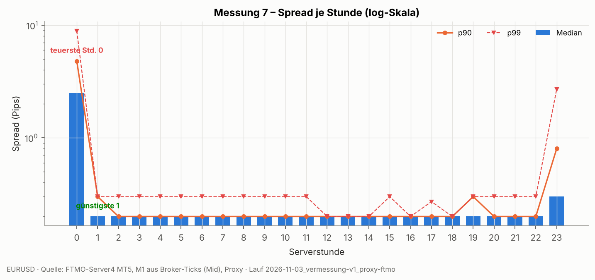

**Ziel-Schwellen – Szenario 0 USD RT/Lot** (Ziel kleiner als Wert ⇒ Kosten über Anteil):

|   Serverstunde | MEZ   |   Kosten_Pips |   Ziel_<_20% |   Ziel_<_30% |   Ziel_<_50% |
|---------------:|:------|--------------:|-------------:|-------------:|-------------:|
|              0 | 22/23 |           2.5 |         12.5 |         8.33 |          5   |
|              1 | 0/23  |           0.2 |          1   |         0.67 |          0.4 |
|              2 | 0/1   |           0.2 |          1   |         0.67 |          0.4 |
|              3 | 1/2   |           0.2 |          1   |         0.67 |          0.4 |
|              4 | 2/3   |           0.2 |          1   |         0.67 |          0.4 |
|              5 | 3/4   |           0.2 |          1   |         0.67 |          0.4 |
|              6 | 4/5   |           0.2 |          1   |         0.67 |          0.4 |
|              7 | 5/6   |           0.2 |          1   |         0.67 |          0.4 |
|              8 | 6/7   |           0.2 |          1   |         0.67 |          0.4 |
|              9 | 7/8   |           0.2 |          1   |         0.67 |          0.4 |
|             10 | 8/9   |           0.2 |          1   |         0.67 |          0.4 |
|             11 | 9/10  |           0.2 |          1   |         0.67 |          0.4 |
|             12 | 10/11 |           0.2 |          1   |         0.67 |          0.4 |
|             13 | 11/12 |           0.2 |          1   |         0.67 |          0.4 |
|             14 | 12/13 |           0.2 |          1   |         0.67 |          0.4 |
|             15 | 13/14 |           0.2 |          1   |         0.67 |          0.4 |
|             16 | 14/15 |           0.2 |          1   |         0.67 |          0.4 |
|             17 | 15/16 |           0.2 |          1   |         0.67 |          0.4 |
|             18 | 16/17 |           0.2 |          1   |         0.67 |          0.4 |
|             19 | 17/18 |           0.2 |          1   |         0.67 |          0.4 |
|             20 | 18/19 |           0.2 |          1   |         0.67 |          0.4 |
|             21 | 19/20 |           0.2 |          1   |         0.67 |          0.4 |
|             22 | 20/21 |           0.2 |          1   |         0.67 |          0.4 |
|             23 | 21/22 |           0.3 |          1.5 |         1    |          0.6 |

**Ziel-Schwellen – Szenario 5 USD RT/Lot** (Ziel kleiner als Wert ⇒ Kosten über Anteil):

|   Serverstunde | MEZ   |   Kosten_Pips |   Ziel_<_20% |   Ziel_<_30% |   Ziel_<_50% |
|---------------:|:------|--------------:|-------------:|-------------:|-------------:|
|              0 | 22/23 |           3   |         15   |        10    |          6   |
|              1 | 0/23  |           0.7 |          3.5 |         2.33 |          1.4 |
|              2 | 0/1   |           0.7 |          3.5 |         2.33 |          1.4 |
|              3 | 1/2   |           0.7 |          3.5 |         2.33 |          1.4 |
|              4 | 2/3   |           0.7 |          3.5 |         2.33 |          1.4 |
|              5 | 3/4   |           0.7 |          3.5 |         2.33 |          1.4 |
|              6 | 4/5   |           0.7 |          3.5 |         2.33 |          1.4 |
|              7 | 5/6   |           0.7 |          3.5 |         2.33 |          1.4 |
|              8 | 6/7   |           0.7 |          3.5 |         2.33 |          1.4 |
|              9 | 7/8   |           0.7 |          3.5 |         2.33 |          1.4 |
|             10 | 8/9   |           0.7 |          3.5 |         2.33 |          1.4 |
|             11 | 9/10  |           0.7 |          3.5 |         2.33 |          1.4 |
|             12 | 10/11 |           0.7 |          3.5 |         2.33 |          1.4 |
|             13 | 11/12 |           0.7 |          3.5 |         2.33 |          1.4 |
|             14 | 12/13 |           0.7 |          3.5 |         2.33 |          1.4 |
|             15 | 13/14 |           0.7 |          3.5 |         2.33 |          1.4 |
|             16 | 14/15 |           0.7 |          3.5 |         2.33 |          1.4 |
|             17 | 15/16 |           0.7 |          3.5 |         2.33 |          1.4 |
|             18 | 16/17 |           0.7 |          3.5 |         2.33 |          1.4 |
|             19 | 17/18 |           0.7 |          3.5 |         2.33 |          1.4 |
|             20 | 18/19 |           0.7 |          3.5 |         2.33 |          1.4 |
|             21 | 19/20 |           0.7 |          3.5 |         2.33 |          1.4 |
|             22 | 20/21 |           0.7 |          3.5 |         2.33 |          1.4 |
|             23 | 21/22 |           0.8 |          4   |         2.67 |          1.6 |

**Ziel-Schwellen – Szenario 7 USD RT/Lot** (Ziel kleiner als Wert ⇒ Kosten über Anteil):

|   Serverstunde | MEZ   |   Kosten_Pips |   Ziel_<_20% |   Ziel_<_30% |   Ziel_<_50% |
|---------------:|:------|--------------:|-------------:|-------------:|-------------:|
|              0 | 22/23 |           3.2 |         16   |        10.67 |          6.4 |
|              1 | 0/23  |           0.9 |          4.5 |         3    |          1.8 |
|              2 | 0/1   |           0.9 |          4.5 |         3    |          1.8 |
|              3 | 1/2   |           0.9 |          4.5 |         3    |          1.8 |
|              4 | 2/3   |           0.9 |          4.5 |         3    |          1.8 |
|              5 | 3/4   |           0.9 |          4.5 |         3    |          1.8 |
|              6 | 4/5   |           0.9 |          4.5 |         3    |          1.8 |
|              7 | 5/6   |           0.9 |          4.5 |         3    |          1.8 |
|              8 | 6/7   |           0.9 |          4.5 |         3    |          1.8 |
|              9 | 7/8   |           0.9 |          4.5 |         3    |          1.8 |
|             10 | 8/9   |           0.9 |          4.5 |         3    |          1.8 |
|             11 | 9/10  |           0.9 |          4.5 |         3    |          1.8 |
|             12 | 10/11 |           0.9 |          4.5 |         3    |          1.8 |
|             13 | 11/12 |           0.9 |          4.5 |         3    |          1.8 |
|             14 | 12/13 |           0.9 |          4.5 |         3    |          1.8 |
|             15 | 13/14 |           0.9 |          4.5 |         3    |          1.8 |
|             16 | 14/15 |           0.9 |          4.5 |         3    |          1.8 |
|             17 | 15/16 |           0.9 |          4.5 |         3    |          1.8 |
|             18 | 16/17 |           0.9 |          4.5 |         3    |          1.8 |
|             19 | 17/18 |           0.9 |          4.5 |         3    |          1.8 |
|             20 | 18/19 |           0.9 |          4.5 |         3    |          1.8 |
|             21 | 19/20 |           0.9 |          4.5 |         3    |          1.8 |
|             22 | 20/21 |           0.9 |          4.5 |         3    |          1.8 |
|             23 | 21/22 |           1   |          5   |         3.33 |          2   |

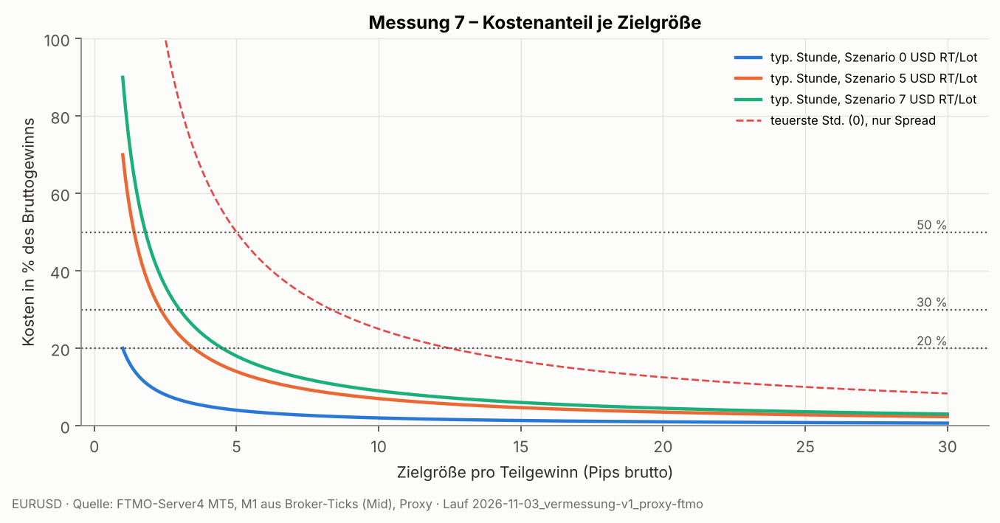

**Symbolspezifikation der Datenquelle (Swap etc.):**

| name   |   spread |   trade_contract_size |   point |   digits |   swap_mode |   swap_long |   swap_short |
|:-------|---------:|----------------------:|--------:|---------:|------------:|------------:|-------------:|
| EURUSD |        7 |                100000 |   1e-05 |        5 |           1 |      -10.73 |         0.44 |

swap_mode 1 = Punkte → Swap Long -1.073 Pips/Nacht, Short 0.044 Pips/Nacht (dreifach am Mittwoch, sofern Broker-Standard). **Gilt für diese Quelle, nicht für Eightcap.**

**Aussage:** ⚪ NEUTRAL – Spread-Median typische Stunde 0.20 Pips (günstigste 1h 0.20, teuerste 0h 2.50). Nur Spread: Kosten > 20 % ab Ziel < 1.0 Pips, > 30 % ab < 0.7, > 50 % ab < 0.4 Pips. Kommission OFFEN (nicht aus Eightcap-Kontodaten belegt); bei 7 USD RT/Lot (= 0,70 Pips, nur Szenario) verschieben sich die Grenzen auf 4.5 / 3.0 / 1.8 Pips.

---
## Datenqualität

| Prüfung | Ergebnis |
|---|---|
| zeitraum_utc | 2025-01-01 22:05:00+00:00 – 2026-05-15 20:54:00+00:00 |
| m1_bars | 506630 |
| duplikate | 0 |
| handelstage | 355 |
| tage_unter_1000_bars | [] |
| bars_an_wochenenden_server | 0 |
| luecken_gesamt | 363 |
| luecken_wochenende | 73 |
| luecken_rollover_23_01 | 290 |
| luecken_sonstige | 0 |
| sprung_gt_10pips_ausser_wochenende | 5 |
| m1_range_p50_p99_max | [1.3, 6.9, 95.7] |
| m1_range_gt_20pips | 188 |
| anteil_bars_range_ge_X | {3: 10.5, 5: 2.58, 10: 0.31, 20: 0.04} |
| null_range_bars_% | 0.63 |
| ohlc_inkonsistent | 0 |
| spread_spitzen_n | 188 |
| spread_spitzen_nach_serverstunde | {0: 183, 2: 2, 23: 3} |
| spread_median_gesamt | 0.2 |

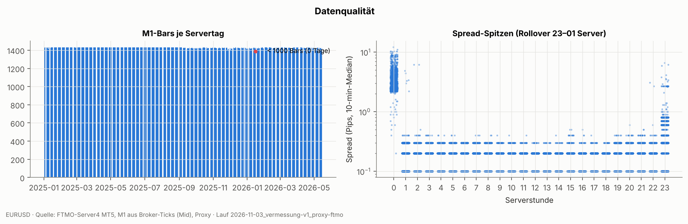

---
## Methodik

**Zeit:** intern UTC. Serverzeit = New York + 7 h (GMT+2/+3, Tageswechsel = NY 17:00; Eightcap-Standard).
MEZ = Europe/Berlin (inkl. Sommerzeit). Sessions in Ortszeit (DST-korrekt): Asien = Tokio 09–18 JST ohne London/NY;
London = London 08–17 ohne NY; Überlappung = London und NY 08–17 ET gleichzeitig; New York = NY ohne London;
Spät/Rollover = Rest (NY-Nachmittag bis Tokio-Öffnung, enthält Rollover 23–01 Server).

**Einstiege:** jede Minute (Close des M1-Bars bzw. letzter Tick der Minute), Long und Short. Preise = Mid (Ticks)
bzw. gelieferte Bar-Preise; Kosten werden getrennt in Messung 7 betrachtet (MAE ist spreadfrei).

**Def. A (Hauptmaß, Nachkauf-relevant):** Long: laufendes Minimum m ab Einstieg; Ende, sobald Kurs ≥ m + X.
MAE = Einstieg − m. Short gespiegelt. **Def. B:** Ende erst bei Einstieg + X. Kappung nach 30 Kalendertagen →
„zensiert“ (MAE bis dahin, als Untergrenze in Perzentilen; enthält auch Einstiege kurz vor Datenende). Wochenenden werden durchlaufen (Position bleibt offen).

**Intrabar (nur Bar-Daten):** Standard „adverse first“ (Long: O→L→H→C). Sensitivität „favorable first“
(O→H→L→C) im Bericht. Mit Tickdaten (1-s-Basis) entfällt die Unschärfe praktisch.

**Zufallspfad-Benchmark:** Bar-Formen (High/Low/Close relativ zum Vor-Close) innerhalb jedes Servertages zufällig
permutiert. Erhält Tagesvolatilität, Bar-Ranges, Tageslücken; zerstört Trend/Rückkehr innerhalb des Tages.
Theorie (Brownsche Bewegung ohne Drift): MAE vor X-Rücklauf ist exponentialverteilt mit Mittel X,
unabhängig von der Volatilität.

**Regime:** Tagesrange je Servertag (≥ 600 M1-Bars), ATR14 = Mittel der 14 Vortage (ex ante). Quintile.

**Rückkehrneigung:** 1-min-Raster (Lücken ≤ 30 min vorwärts gefüllt), nur Renditen innerhalb eines Servertags.
VR mit überlappenden q-Renditen; AC1 nicht überlappend. Nullband: n Permutationen der 1-min-Renditen innerhalb
des Tages. Halbwertszeit: d_t = log P − gleitendes Mittel(W); d_{t+1} = β·d_t; HWZ = −ln2/ln β.

**Extremphasen:** ZigZag mit Umkehrschwelle X auf M1-High/Low; Bein = Bewegung ohne X-Rücklauf.

**Kosten:** Spread je Serverstunde (Median/p90/p99 über Bars). Ziel-Schwelle für Kostenanteil s: Ziel < Kosten/s.
Kommission nur, wenn in der Konfiguration belegt; sonst Szenarien (ausdrücklich keine Annahme).

**Bewertungsregeln (M-Regeln):**
- M1: p99 real/Zufallspfad < 0,93 → HILFT, > 1,07 → SCHADET, sonst NEUTRAL. M1b: zensiert > 1 % → SCHADET.
- M2: max/min p99 über Stunden ≥ 1,3 **und** Halbjahres-Stabilität (Spearman p99) ≥ 0,5 → HILFT (als Zeitfilter nutzbar), sonst NEUTRAL.
- M3: p99 wildestes/ruhigstes Quintil ex ante ≥ 1,25 → HILFT (vorab skalierbar), sonst NEUTRAL.
- M4: p99 gegen Trend an Trendtagen / Rangetage > 1,3 → SCHADET, sonst NEUTRAL.
- M5: Zellen (Session×Horizont), die signifikant < 1 sind **und** in beiden Halbjahren < 1 liegen, übersteigen die entsprechenden > 1-Zellen um > 2 → HILFT (umgekehrt SCHADET).
- M6: längstes Bein real/Zufallspfad > 1,3 → SCHADET (fette Schwänze), sonst NEUTRAL.
- M7: ohne Bewertung (reine Kostengrenzen).
